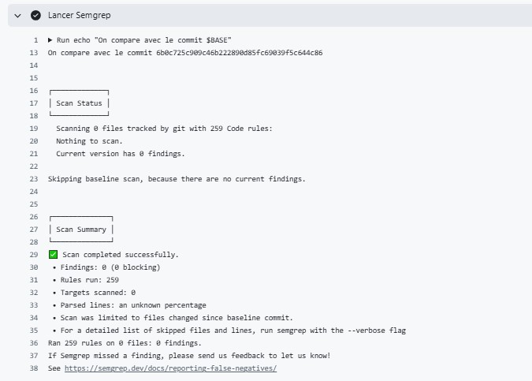
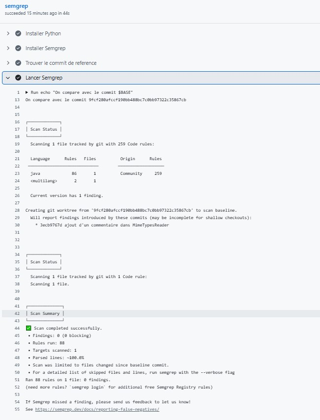
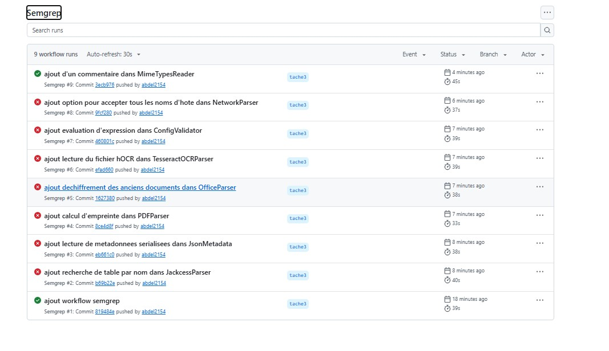
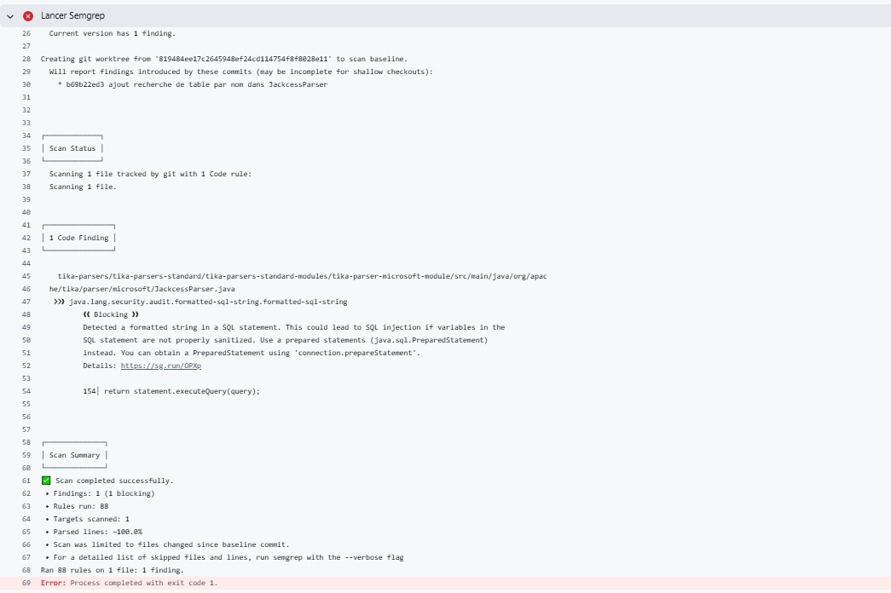
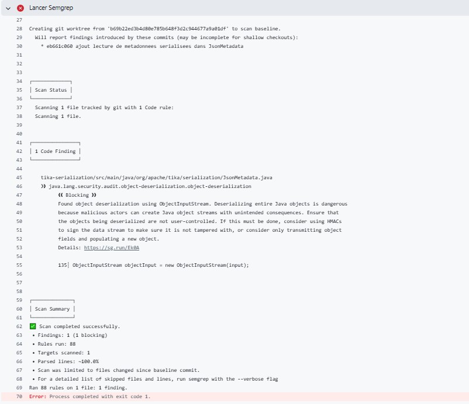
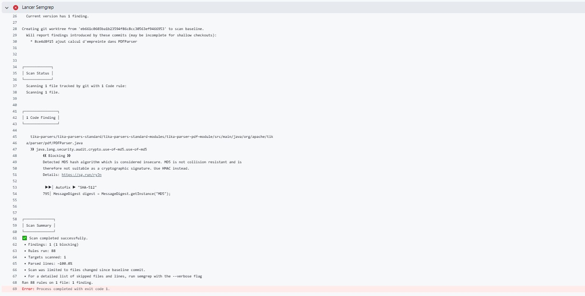
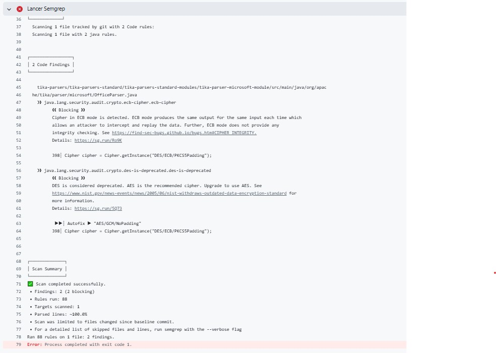
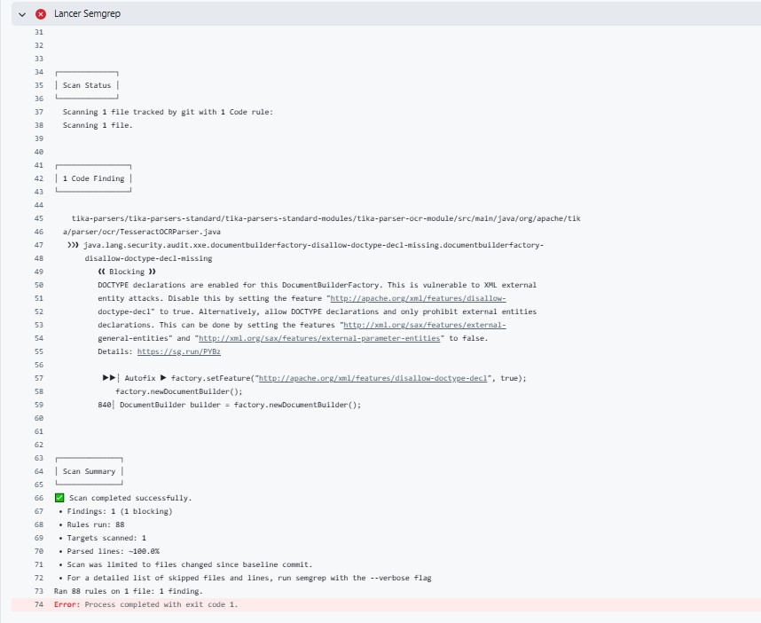
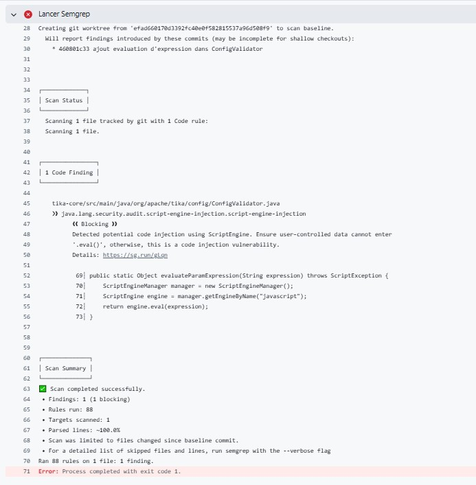
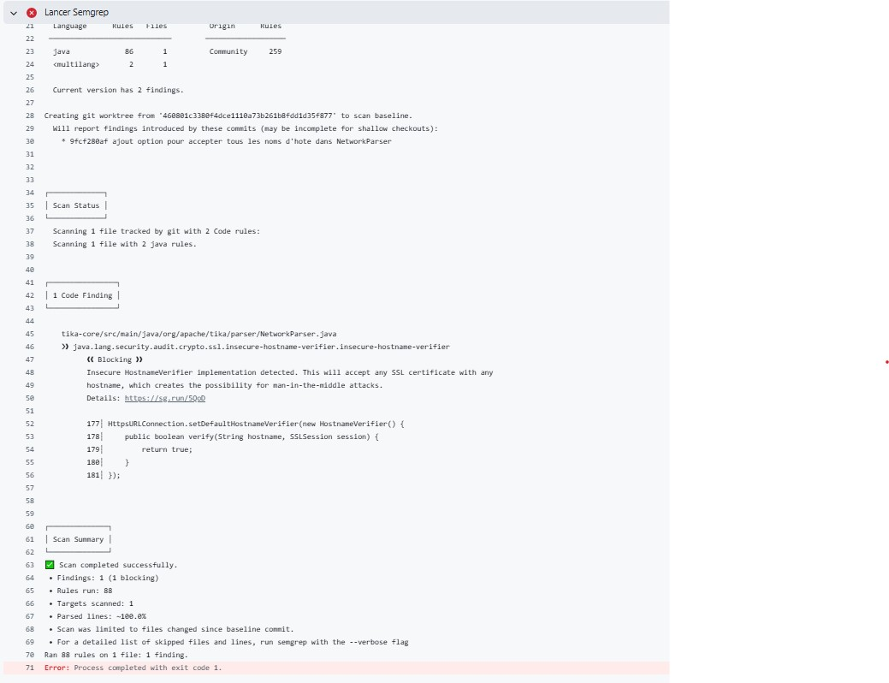

# IFT3913 – Tâche 3 : automatisation des tests de sécurité avec Semgrep

Binôme : Messaad Abdelmouhcine (`abdel2154`) · Cherir Roustom Abdeldjalel (`R0us24`)

Cas d'étude : Apache Tika (fork de [umontreal-diro/tika](https://github.com/umontreal-diro/tika)), branche `tache3`

> Le rapport de la tâche 2 se trouve sur la branche [`main`](https://github.com/abdel2154/tika/tree/main). Le README original de Tika a été conservé dans [README-TIKA.md](README-TIKA.md).

## Résumé

Dans cette tâche, nous avons ajouté au projet Tika un contrôle de sécurité automatique. À chaque commit, un workflow GitHub Actions lance Semgrep et fait échouer le build si le commit introduit une nouvelle vulnérabilité. Pour vérifier que ce contrôle fonctionne, nous avons ensuite ajouté volontairement sept vulnérabilités de types différents, une par commit, et observé que chacune faisait passer le build au rouge.

Semgrep relevait 3 alertes dans Tika avant nos modifications, et 11 après (les 3 d'origine et 8 nouvelles, car l'une de nos vulnérabilités déclenche deux règles). Une action [`rickroll`](.github/actions/rickroll/action.yml) est appelée lorsqu'un test du workflow [`tache2.yml`](.github/workflows/tache2.yml) échoue.

---

## 1. Le workflow Semgrep

### Point de départ

Avant d'écrire le workflow, nous avons lancé Semgrep sur les cinq modules du cas d'étude (`tika-core`, `tika-serialization` et les modules `pdf`, `ocr` et `microsoft`) avec les ensembles de règles `p/java` et `p/security-audit`. Ce premier scan a relevé 3 alertes déjà présentes dans Tika : deux parseurs XML qui acceptent les entités externes (dans `MimeTypesReader.java` et `XMLReaderUtils.java`) et un socket non chiffré (dans `NetworkParser.java`). Le rapport complet est dans [`semgrep-avant.json`](tache3/semgrep-avant.json).

Un workflow qui échoue dès que Semgrep trouve quelque chose serait rouge en permanence, à cause de ces trois alertes que nous n'avons pas introduites. Or l'énoncé demande de faire échouer le build lorsqu'un commit introduit une nouvelle vulnérabilité. Il fallait donc comparer chaque commit à un état de référence.

### Fonctionnement

Le workflow se trouve dans [`.github/workflows/semgrep.yml`](.github/workflows/semgrep.yml). Il est déclenché à chaque `push` et à chaque `pull_request`.

Il récupère d'abord le code avec tout l'historique Git (`fetch-depth: 0`), nécessaire pour que Semgrep retrouve l'ancien commit lors de la comparaison. Il installe ensuite Python 3.12 et Semgrep.

Il détermine ensuite le commit de référence, appelé `BASE`. Pour une pull request, il s'agit du commit de la branche cible (`base.sha`). Pour un push, c'est le dernier commit avant le push (`github.event.before`). Lors du premier push d'une nouvelle branche, GitHub donne la valeur `000…0` comme commit précédent. Dans ce cas, le workflow prend le commit parent (`HEAD~1`).

Le scan est ensuite lancé :

```bash
semgrep scan --config p/java --config p/security-audit --metrics=off \
  --baseline-commit $BASE --error --json-output=semgrep.json <les 5 modules du cas d'étude>
```

Enfin, le rapport `semgrep.json` est sauvegardé comme artefact du run, même lorsque le job échoue (`if: always()`). Le détail des alertes peut ainsi être consulté après le run.

### Justification des choix

Avec l'option `--baseline-commit`, Semgrep compare le code actuel au commit de référence et ne signale que les alertes qui n'existaient pas auparavant. Il ne scanne que les fichiers modifiés depuis ce commit (un run dure environ 40 secondes). Avec l'option `--error`, Semgrep se termine avec le code 1 dès qu'il reste au moins une alerte, et c'est ce code de retour qui fait échouer le build.

Les autres choix sont les suivants :

- Les ensembles de règles `p/java` et `p/security-audit` couvrent à la fois les erreurs propres à Java et les problèmes de sécurité courants (injections, cryptographie, XML, HTTPS, etc.).
- Le scan se limite aux cinq modules du cas d'étude. Le reste de Tika n'est pas concerné par la tâche.
- La version de Semgrep est fixée à 1.185.0, la même que celle utilisée en local. Les résultats de la CI et les rapports avant/après restent ainsi comparables si une nouvelle version modifie les règles.
- L'option `--metrics=off` évite l'envoi de statistiques d'utilisation à Semgrep.

Semgrep ignore par défaut les dossiers de tests. Les vulnérabilités ont donc été placées dans `src/main/java`.

### Validation

Le workflow a été validé dans trois situations.

Premier cas : un commit sans code Java. Le premier commit, qui ajoute uniquement le workflow, donne un [run vert](https://github.com/abdel2154/tika/actions/runs/43621239539). Aucun fichier des modules n'ayant changé, Semgrep n'a rien à analyser.



Deuxième cas : un commit qui ajoute une vulnérabilité. Chacun des sept commits de la section 2 donne un run rouge qui ne signale que la vulnérabilité ajoutée. Dans le run de la vulnérabilité 7, le fichier modifié, `NetworkParser.java`, contenait déjà l'alerte « socket non chiffré ». Le journal indique « Current version has 2 findings », mais une seule alerte est signalée, la nouvelle.

Troisième cas : un commit qui modifie un fichier déjà vulnérable sans ajouter de vulnérabilité. Nous avons ajouté un commentaire dans `MimeTypesReader.java`, qui contient déjà un parseur XML non protégé. Le fichier est analysé (« Current version has 1 finding »), mais comme l'alerte existait déjà dans le commit de référence, le [run reste vert](https://github.com/abdel2154/tika/actions/runs/43622459870).



La vue d'ensemble des runs Semgrep montre la séquence : un run vert, sept rouges, puis un vert.



---

## 2. Les sept vulnérabilités

Chaque vulnérabilité prend la forme d'une méthode ajoutée à la fin d'une classe existante. Pour chacune, nous avons choisi une classe dont le rôle est cohérent avec la méthode ajoutée. Chaque vulnérabilité a fait l'objet d'un commit et d'un push séparés, ce qui donne un run distinct pour chacune.

| # | Type | Fichier | Règle Semgrep | Run |
|---|---|---|---|---|
| 1 | Injection SQL | `JackcessParser.java` | `formatted-sql-string` | [rouge](https://github.com/abdel2154/tika/actions/runs/43622141763) |
| 2 | Désérialisation non sûre | `JsonMetadata.java` | `object-deserialization` | [rouge](https://github.com/abdel2154/tika/actions/runs/43622181712) |
| 3 | Hachage faible (MD5) | `PDFParser.java` | `use-of-md5` | [rouge](https://github.com/abdel2154/tika/actions/runs/43622199462) |
| 4 | Chiffrement faible (DES) | `OfficeParser.java` | `des-is-deprecated` + `ecb-cipher` | [rouge](https://github.com/abdel2154/tika/actions/runs/43622219995) |
| 5 | Lecture d'entités XML externes | `TesseractOCRParser.java` | `documentbuilderfactory-disallow-doctype-decl-missing` | [rouge](https://github.com/abdel2154/tika/actions/runs/43622239832) |
| 6 | Injection de code | `ConfigValidator.java` | `script-engine-injection` | [rouge](https://github.com/abdel2154/tika/actions/runs/43622258901) |
| 7 | Certificat HTTPS mal vérifié | `NetworkParser.java` | `insecure-hostname-verifier` | [rouge](https://github.com/abdel2154/tika/actions/runs/43622278212) |

Notre première liste comprenait aussi une injection de commande (`Runtime.exec`) et l'utilisation de `new Random()` pour générer un jeton. En les testant localement, nous avons constaté que les règles utilisées ne les détectaient pas. Nous les avons donc remplacées par l'injection de code et le certificat HTTPS mal vérifié.

### 1. Injection SQL – `JackcessParser.findRowsByTableName`

`JackcessParser`, dans le module `tika-parser-microsoft-module`, lit les bases Microsoft Access. Nous y avons ajouté une méthode qui recherche une table à partir de son nom. La requête est construite en insérant directement ce nom dans la chaîne SQL :

```java
String query = "SELECT * FROM tables WHERE name = '" + tableName + "'";
return statement.executeQuery(query);
```

`tableName` provient du fichier analysé, donc d'une source externe. Avec un nom comme `x' OR '1'='1`, la condition devient toujours vraie et la requête renvoie toutes les lignes. Un nom plus élaboré pourrait modifier ou supprimer des données. Il faudrait utiliser un `PreparedStatement`, qui sépare la requête des données.

Semgrep l'a détectée avec la règle `formatted-sql-string`.



### 2. Désérialisation non sûre – `JsonMetadata.fromSerializedStream`

Le module `tika-serialization` sert à sérialiser et à relire les métadonnées. Nous avons ajouté à `JsonMetadata` une méthode qui relit des métadonnées sauvegardées avec la sérialisation native de Java :

```java
ObjectInputStream objectInput = new ObjectInputStream(input);
return (Metadata) objectInput.readObject();
```

Le cast en `Metadata` ne protège pas : `readObject()` reconstruit n'importe quel objet décrit dans le flux, à condition que sa classe soit présente dans le classpath, et ce avant que le cast ne soit vérifié. Un flux construit par un attaquant peut enchaîner des classes existantes (des « gadgets ») de manière à exécuter du code. Il faudrait soit éviter la sérialisation Java pour des données externes, soit restreindre les classes acceptées avec un filtre (`ObjectInputFilter`).

Semgrep l'a signalée avec la règle `object-deserialization`.



### 3. Hachage faible – `PDFParser.computeChecksum`

Dans le module `tika-parser-pdf-module`, nous avons ajouté à `PDFParser` une méthode qui calcule une empreinte d'un fichier PDF, par exemple pour l'identifier ou détecter des doublons. Elle utilise l'algorithme MD5 :

```java
MessageDigest digest = MessageDigest.getInstance("MD5");
```

MD5 n'est plus considéré comme sûr : on sait fabriquer deux fichiers différents qui ont la même empreinte (une collision). Un PDF malveillant pourrait ainsi se faire passer pour un document légitime. Il faudrait utiliser SHA-256.

Semgrep l'a détectée avec la règle `use-of-md5`.



### 4. Chiffrement faible – `OfficeParser.decryptLegacyDocument`

`OfficeParser`, dans `tika-parser-microsoft-module`, gère déjà les documents Office protégés par mot de passe. Nous y avons ajouté une méthode qui déchiffre d'« anciens » documents avec DES :

```java
Cipher cipher = Cipher.getInstance("DES/ECB/PKCS5Padding");
```

Cette ligne pose deux problèmes. DES utilise une clé de 56 bits, qu'il est possible de retrouver par force brute. Le mode ECB chiffre deux blocs identiques de la même façon, ce qui laisse apparaître la structure du document chiffré. Il faudrait utiliser AES en mode GCM.

Semgrep produit donc deux alertes sur la même ligne : `des-is-deprecated` pour l'algorithme et `ecb-cipher` pour le mode. Cela explique le total de 8 nouvelles alertes pour 7 vulnérabilités.



### 5. Lecture d'entités XML externes (XXE) – `TesseractOCRParser.parseHocrFile`

Le moteur d'OCR Tesseract peut produire ses résultats au format hOCR, qui est du XML. Nous avons ajouté à `TesseractOCRParser`, dans `tika-parser-ocr-module`, une méthode qui lit ce type de fichier :

```java
DocumentBuilderFactory factory = DocumentBuilderFactory.newInstance();
DocumentBuilder builder = factory.newDocumentBuilder();
return builder.parse(input);
```

Le parseur est créé avec sa configuration par défaut, qui accepte les déclarations `<!DOCTYPE>` et les entités externes. Un fichier contenant par exemple `<!ENTITY x SYSTEM "file:///etc/passwd">` amènerait le parseur à lire un fichier local, ou à contacter un serveur choisi par l'attaquant. Tika fournit déjà la classe `XMLReaderUtils` pour créer des parseurs XML sécurisés, mais cette méthode ne l'utilise pas.

Semgrep l'a détectée avec la règle `documentbuilderfactory-disallow-doctype-decl-missing`.



### 6. Injection de code – `ConfigValidator.evaluateParamExpression`

`ConfigValidator`, dans `tika-core`, sert à valider les paramètres de configuration. Nous y avons ajouté une méthode qui permettrait d'écrire un paramètre sous forme d'expression, par exemple `1024 * 1024`, en la faisant évaluer par un moteur de script :

```java
ScriptEngine engine = manager.getEngineByName("javascript");
return engine.eval(expression);
```

La chaîne provient du fichier de configuration et elle est exécutée comme du code. On peut y écrire `java.lang.Runtime.getRuntime().exec(...)` au lieu d'un simple calcul. Java 17 n'inclut plus de moteur JavaScript, mais la faille devient exploitable dès qu'un moteur est ajouté au classpath.

Semgrep l'a détectée avec la règle `script-engine-injection`.



### 7. Certificat HTTPS mal vérifié – `NetworkParser.acceptAllHostnames`

`NetworkParser`, dans `tika-core`, envoie déjà des documents à un serveur distant pour qu'il les analyse. Nous y avons ajouté une méthode qui permet la connexion à des serveurs dont le certificat ne correspond pas exactement à leur nom :

```java
HttpsURLConnection.setDefaultHostnameVerifier(new HostnameVerifier() {
    public boolean verify(String hostname, SSLSession session) {
        return true;
    }
});
```

Comme `verify` retourne toujours `true`, n'importe quel certificat valide est accepté, même s'il a été émis pour un tout autre domaine. Un attaquant placé entre le client et le serveur (*man-in-the-middle*) pourrait alors lire et modifier les échanges. De plus, ce réglage s'applique à toutes les connexions HTTPS de la JVM, et pas seulement à celles de Tika.

Semgrep l'a détectée avec la règle `insecure-hostname-verifier`. Comme indiqué dans la section 1, l'alerte déjà présente dans ce fichier n'est pas signalée dans ce run.



---

## 3. Comparaison des rapports avant et après

Pour cette comparaison, nous avons lancé un scan complet des cinq modules, sans baseline et avec la même version de Semgrep (1.185.0), à deux moments : avant nos commits ([`semgrep-avant.json`](tache3/semgrep-avant.json)) et après l'ajout de la septième vulnérabilité ([`semgrep-apres.json`](tache3/semgrep-apres.json)).

| Fichier | Règle | Avant | Après |
|---|---|---|---|
| `MimeTypesReader.java` | `saxparserfactory-disallow-doctype-decl-missing` | ligne 223 | ligne 224 |
| `NetworkParser.java` | `unencrypted-socket` | ligne 68 | ligne 71 |
| `XMLReaderUtils.java` | `xmlinputfactory-possible-xxe` | ligne 307 | ligne 307 |
| `JackcessParser.java` | `formatted-sql-string` | — | nouvelle (154) |
| `JsonMetadata.java` | `object-deserialization` | — | nouvelle (135) |
| `PDFParser.java` | `use-of-md5` | — | nouvelle (795) |
| `OfficeParser.java` | `des-is-deprecated` | — | nouvelle (398) |
| `OfficeParser.java` | `ecb-cipher` | — | nouvelle (398) |
| `TesseractOCRParser.java` | `documentbuilderfactory-disallow-doctype-decl-missing` | — | nouvelle (840) |
| `ConfigValidator.java` | `script-engine-injection` | — | nouvelle (69) |
| `NetworkParser.java` | `insecure-hostname-verifier` | — | nouvelle (177) |
| Total | | 3 | 11 |

Les trois alertes d'origine sont toujours présentes après nos modifications. Seuls leurs numéros de ligne ont changé : nous avons ajouté des imports ou un commentaire au-dessus d'elles. Les huit nouvelles alertes correspondent aux sept vulnérabilités introduites, la quatrième en comptant deux.

---

## 4. Le rickroll

L'énoncé demande un rickroll lorsqu'un test échoue. Nous avons d'abord regardé l'action [random-rickroll](https://github.com/TejasvOnly/random-rickroll) suggérée dans l'énoncé. Elle repose cependant sur `node12`, qui n'est plus pris en charge par GitHub Actions, et elle ne fait que commenter des issues. Nous avons donc écrit notre propre action réutilisable, en reprenant son GIF.

L'action se trouve dans [`.github/actions/rickroll/action.yml`](.github/actions/rickroll/action.yml). C'est une action composite qui ajoute une annotation d'erreur contenant le lien vers la vidéo et affiche le GIF de Rick Astley dans le résumé du run, accompagné d'un lien « Cliquez ici pour voir pourquoi le test a echoue ».

Elle est appelée dans [`tache2.yml`](.github/workflows/tache2.yml), juste après les deux étapes qui exécutent les tests :

```yaml
- name: Rickroll si un test echoue
  if: failure() && (steps.tests.outcome == 'failure' || steps.tests_ajoutes.outcome == 'failure')
  uses: ./.github/actions/rickroll
```

La condition limite le rickroll à l'échec des tests ; une erreur de compilation survenue plus tôt ne le déclenche pas.

### Validation

Le comportement a été vérifié en trois commits :

1. L'ajout de l'action seule donne un [run vert](https://github.com/abdel2154/tika/actions/runs/43650529532) : l'étape rickroll est ignorée, comme prévu.
2. Un test a ensuite été cassé volontairement, en changeant la valeur attendue dans `EndianUtilsManualTest`. Le [run est rouge](https://github.com/abdel2154/tika/actions/runs/43650545694) : l'étape de tests échoue et l'étape rickroll s'exécute.
3. Une fois le test réparé, le [run redevient vert](https://github.com/abdel2154/tika/actions/runs/43650569419), sans rickroll.

---

## 5. Déclaration d'utilisation de l'IA générative

Conformément aux [directives de l'Université de Montréal](https://boite-outils.bib.umontreal.ca/c.php?g=743753&p=5377614) :

- Claude (Anthropic, via Claude Code), utilisé par les deux membres du binôme : aide à l'écriture du workflow Semgrep et de l'action rickroll, au choix des vulnérabilités et à la vérification qu'elles sont détectées, à l'exécution des scans et à la rédaction de ce README.

Tous les résultats ont été vérifiés en exécutant réellement Semgrep, en local et dans GitHub Actions (voir les liens ci-dessus).
